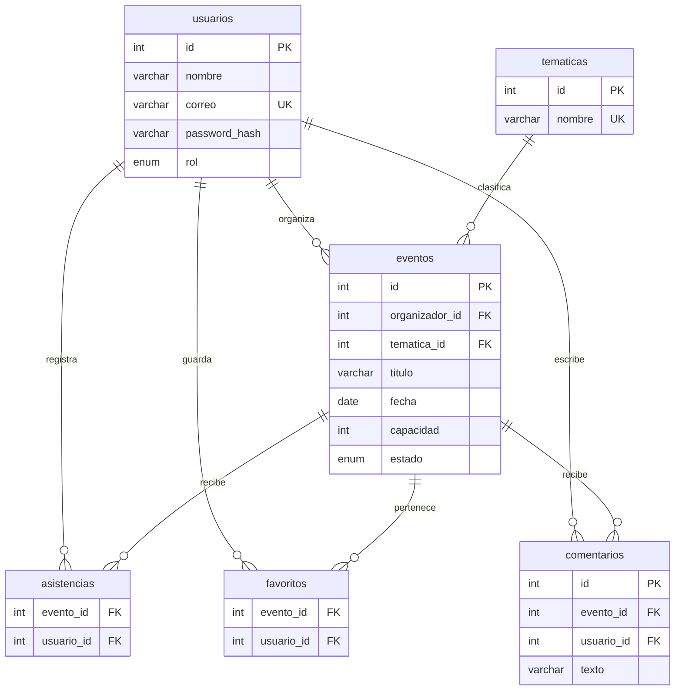

# Garza Night

Garza Night es una aplicación web para publicar, descubrir y gestionar eventos de la comunidad universitaria de la UAEH. Permite limitar el acceso a correos institucionales, administrar asistencia y cupos, guardar favoritos, comentar eventos y mantener un panel administrativo.

## Tecnologías utilizadas

| Capa | Tecnología | Uso |
|---|---|---|
| Servidor web | Apache mediante XAMPP | Ejecuta PHP y sirve el proyecto |
| Backend | PHP | Renderiza las páginas, valida datos y procesa las operaciones |
| Base de datos | MySQL/MariaDB | Guarda usuarios, eventos y relaciones |
| Acceso a datos | PDO | Ejecuta consultas preparadas y maneja errores como excepciones |
| Interfaz | HTML5 y CSS3 | Presenta formularios, tablas, tarjetas y diseño responsivo |
| Interactividad | JavaScript | Actualiza asistencia, favoritos y comentarios sin recargar |
| Comunicación AJAX | Fetch API | Envía JSON a los endpoints de `acciones/` |
| Tipografía | Google Fonts | Utiliza Inter y Space Grotesk |
| Control de versiones | Git | Conserva y comparte el historial del proyecto |

No usa un framework PHP ni una librería JavaScript externa. Las páginas se generan directamente en el servidor con PHP.

## Funcionalidades

### Usuarios

- Registro exclusivo con correo institucional terminado en `@uaeh.edu.mx`.
- Validación del nombre, correo, carrera, descripción y contraseña.
- Contraseñas cifradas con `password_hash()` y verificadas con `password_verify()`.
- Inicio y cierre de sesión mediante sesiones PHP.
- Perfil con eventos publicados, eventos a los que asistirá y favoritos.
- Visita pública limitada a seis eventos mientras no exista sesión.

### Eventos

- Creación y edición con título, descripción, temática, imagen, lugar, fecha, horario, costo, edad mínima, política de bebidas, capacidad y datos adicionales.
- Validación tanto en el navegador como en el servidor.
- Estados activo, cancelado y finalizado.
- Búsqueda y filtros por texto, temática, fecha y costo.
- Orden por fecha, popularidad o antigüedad.
- Histórico exclusivo de eventos cuya fecha ya pasó.
- Cancelación de eventos con eliminación de las asistencias relacionadas.
- Eliminación definitiva mediante las reglas de cascada de la base de datos.

### Asistencia

- Solo usuarios autenticados pueden apuntarse.
- Un usuario no puede apuntarse a su propio evento.
- Un evento cancelado o finalizado no acepta nuevas asistencias.
- El cupo se controla en una transacción y con `FOR UPDATE` para evitar que dos solicitudes rebasen la capacidad.
- La tabla `asistencias` impide mediante una clave única registrar dos veces a una persona.

### Favoritos y comentarios

- Los favoritos permiten agregar o quitar un evento sin recargar la página.
- Cada comentario tiene un máximo de 200 caracteres.
- Los comentarios se muestran de más reciente a más antiguo y se crean dinámicamente con `textContent`, evitando HTML interpretado.
- Los eventos cancelados no reciben comentarios.

### Administración

- El panel exige el rol `admin`.
- Permite consultar estadísticas generales.
- Permite crear, renombrar y eliminar temáticas; una temática utilizada no puede borrarse.
- Permite editar datos básicos de usuarios y eliminar usuarios que no sean administradores.
- Permite eliminar comentarios recientes.
- Un administrador puede consultar y gestionar todos los eventos.

## Arquitectura

El proyecto usa una arquitectura en capas sencilla y recursos compartidos:

```text
Navegador
  ├── HTML generado por PHP
  ├── CSS estático
  └── JavaScript y Fetch API
          │
          ▼
PHP y sesiones
  ├── includes/     lógica compartida
  ├── acciones/     endpoints JSON
  ├── páginas raíz  entrada de usuario y vistas
  └── admin/        panel restringido
          │
          ▼
PDO
          │
          ▼
MySQL/MariaDB
```

El flujo de una petición tradicional es:

1. El navegador solicita una página PHP.
2. `includes/header.php` carga sesión, seguridad y recursos comunes.
3. La página valida permisos y parámetros.
4. `includes/db.php` obtiene la conexión PDO.
5. PHP ejecuta consultas preparadas y genera HTML.
6. El navegador recibe la respuesta completa.

Las acciones dinámicas usan otra variante:

1. JavaScript ejecuta `fetch()`.
2. `app.js` incluye el token CSRF y convierte los datos a JSON.
3. Un archivo de `acciones/` valida método, sesión, token y parámetros.
4. El servidor modifica MySQL y devuelve JSON.
5. JavaScript actualiza el contenido existente sin recargar.

## Base de datos

El esquema se encuentra en [`sql/esquema.sql`](sql/esquema.sql). Usa MySQL/MariaDB con el motor InnoDB.



Las claves únicas `uq_asistencia` y `uq_favorito` impiden duplicados. Los registros relacionados usan `ON DELETE CASCADE` para eliminar asistencias, favoritos y comentarios cuando se elimina su usuario o evento. Una temática no puede eliminarse con `ON DELETE RESTRICT` si todavía tiene eventos.

## Instalación en XAMPP

1. Instalar XAMPP con Apache, PHP y MySQL/MariaDB.
2. Colocar el proyecto en `C:\xampp\htdocs\garza-night`.
3. Iniciar Apache y MySQL desde el panel de XAMPP.
4. Abrir phpMyAdmin en `http://localhost/phpmyadmin`.
5. Importar [`sql/esquema.sql`](sql/esquema.sql).
6. Revisar la conexión en [`includes/config.php`](includes/config.php):

   ```php
   const DB_HOST = 'localhost';
   const DB_NAME = 'garza_night';
   const DB_USER = 'root';
   const DB_PASS = 'root';
   const BASE_URL = '/garza-night';
   ```

7. Abrir `http://localhost/garza-night/index.php`.

Si MySQL fue configurado sin contraseña, debe cambiarse `DB_PASS` a `''`. El usuario administrador creado por el esquema es:

- Correo: `admin@uaeh.edu.mx`
- Contraseña: `password`

Esta contraseña de demostración debe cambiarse antes de publicar el proyecto.

## Seguridad implementada

- **Consultas preparadas PDO:** separan SQL de los datos y reducen el riesgo de inyección.
- **Escape HTML:** `e()` usa `htmlspecialchars()` antes de imprimir datos.
- **Contraseñas cifradas:** no se guarda el texto original.
- **Sesiones:** se usa `session_regenerate_id(true)` al iniciar sesión.
- **Cookie de sesión:** tiene `httponly` y `samesite=Lax`.
- **CSRF:** formularios y fetch incluyen un token aleatorio almacenado en sesión.
- **Control de permisos:** se verifica sesión y rol en páginas administrativas.
- **Validación en servidor:** no se confía únicamente en HTML o JavaScript.
- **Respuestas JSON:** los endpoints HTTP indican estados como 400, 401, 403, 404, 409 y 500.
- **Prevención de XSS en comentarios:** JavaScript usa `textContent`, no `innerHTML`.
- **Integridad del cupo:** una transacción y bloqueo `FOR UPDATE` evitan sobreventa.

## Estructura de archivos

```text
garza-night/
├── index.php              Página principal y filtros
├── historico.php          Eventos finalizados
├── evento.php             Detalle de un evento
├── crear-evento.php       Alta de eventos
├── editar-evento.php      Modificación de eventos
├── cancelar-evento.php    Cancelación
├── eliminar-evento.php    Eliminación
├── mis-eventos.php        Gestión de eventos
├── perfil.php             Perfil y secciones del usuario
├── registro.php           Registro
├── login.php              Inicio de sesión
├── logout.php             Cierre de sesión
├── acciones/
│   ├── asistir.php        Endpoint de asistencia
│   ├── favorito.php       Endpoint de favoritos
│   └── comentar.php       Endpoint de comentarios
├── admin/
│   ├── index.php          Estadísticas
│   ├── usuarios.php       Administración de usuarios
│   ├── editar-usuario.php Edición de usuarios
│   ├── tematicas.php      Administración de temáticas
│   └── comentarios.php    Moderación de comentarios
├── includes/
│   ├── auth.php           Sesiones y permisos
│   ├── config.php         Configuración
│   ├── csrf.php           Protección CSRF
│   ├── db.php             Conexión PDO
│   ├── eventos.php        CRUD y validación de eventos
│   ├── feed.php           Consultas y filtros
│   ├── funciones.php      Utilidades compartidas
│   ├── social.php         Favoritos y comentarios
│   └── json.php           Ayudas para endpoints JSON
├── assets/
│   ├── css/               Variables, estilos base y componentes
│   └── js/                Interactividad y validaciones
└── sql/esquema.sql        Base de datos completa
```

## Pruebas manuales recomendadas

1. Registrar una cuenta con correo válido e intentar uno inválido.
2. Comprobar contraseñas largas sin letras o sin números.
3. Entrar con usuario normal y intentar abrir una ruta administrativa.
4. Crear un evento con una capacidad menor que uno existente al editarlo.
5. Apuntarse dos veces y comprobar que no se duplica la asistencia.
6. Apuntar varios usuarios hasta agotar el cupo.
7. Cancelar un evento y comprobar que sus asistentes desaparecen.
8. Agregar y quitar favoritos.
9. Publicar comentarios válidos y uno vacío o mayor de 200 caracteres.
10. Eliminar una temática usada y comprobar que el sistema la protege.
11. Comprobar que eliminar un usuario afecta únicamente su actividad relacionada.
12. Verificar el diseño en pantalla amplia y móvil.
